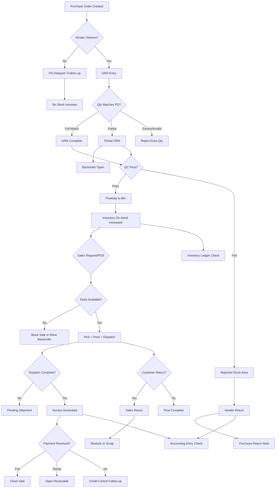

# Purchase Inventory Sales Flow

## End-to-End Functional Flow

```mermaid
flowchart LR
    A[Purchase Requisition] --> B[RFQ / Vendor Quote]
    B --> C[Purchase Order]
    C --> D[Goods Receipt Note (GRN)]
    D --> E[Quality Check]
    E --> F[Putaway to Warehouse/Bin]
    F --> G[Inventory On-Hand Increased]
    G --> H[Inventory Available for Sale]

    H --> I[Sales Order / POS Sale]
    I --> J[Pick List]
    J --> K[Pack]
    K --> L[Dispatch / Invoice]
    L --> M[Inventory On-Hand Decreased]
    L --> N[Payment Collection]
    N --> O[Accounting Entries]

    D --> P[Purchase Accounting Entry]
    C --> Q[PO Status Tracking]
    I --> R[Sales Status Tracking]
```

## Negative/Exception Paths



## Functional Test Checkpoints

1. Purchase side: requisition, PO approval, GRN posting, and inventory increase.
2. Inventory side: putaway location updates, available quantity, and status transitions.
3. Sales side: sale creation, pick/pack/dispatch, inventory deduction, invoice/payment.
4. Side effects: inventory ledger rows and accounting entries at each branch.
5. Negative flows: partial GRN, rejected QC, insufficient stock, partial/no payment, sales return.
