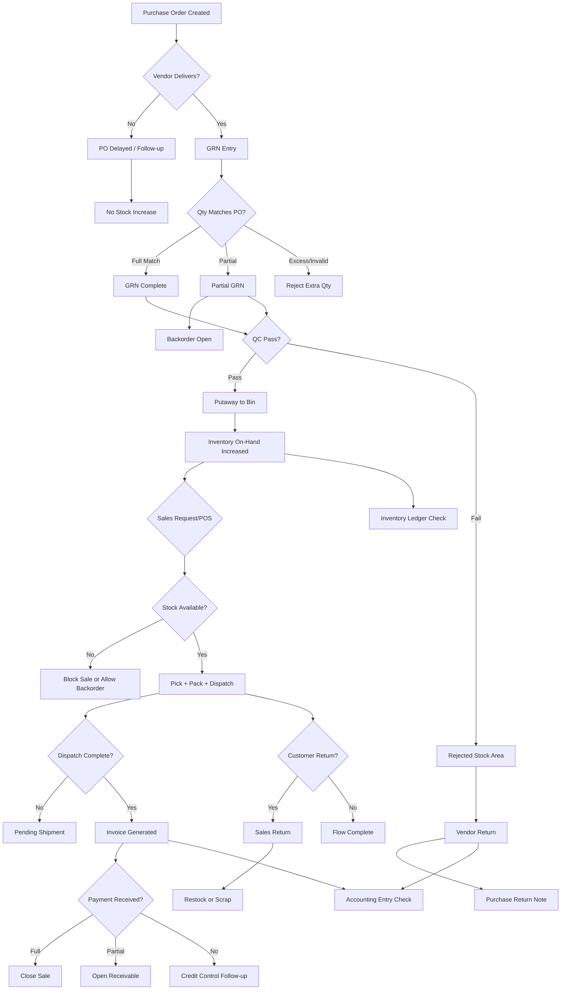
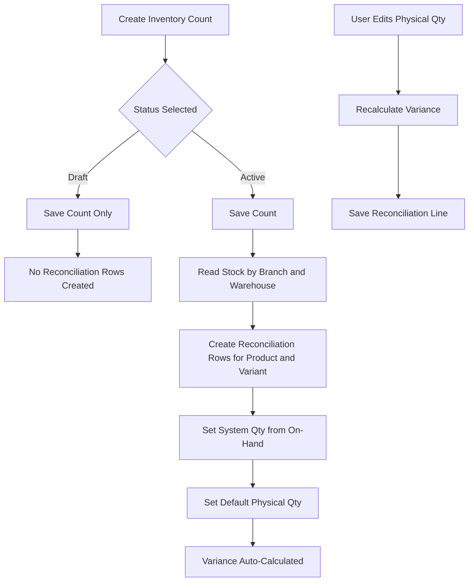
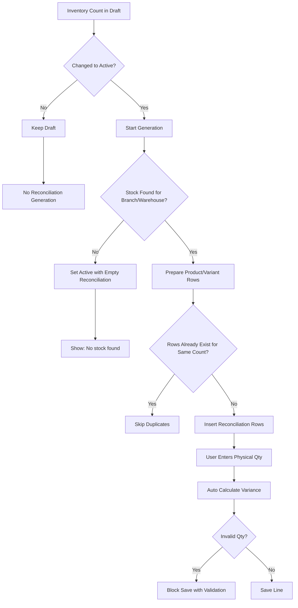

# Purchase Inventory Sales Flow

## End-to-End Functional Flow

```mermaid
flowchart LR
    A[Purchase Requisition] --> B[RFQ / Vendor Quote]
    B --> C[Purchase Order]
    C --> D[Goods Receipt Note (GRN)]
    D --> E[Quality Check]
    E --> F[Putaway to Warehouse/Bin]
    F --> G[Inventory On-Hand Increased]
    G --> H[Inventory Available for Sale]

    H --> I[Sales Order / POS Sale]
    I --> J[Pick List]
    J --> K[Pack]
    K --> L[Dispatch / Invoice]
    L --> M[Inventory On-Hand Decreased]
    L --> N[Payment Collection]
    N --> O[Accounting Entries]

    D --> P[Purchase Accounting Entry]
    C --> Q[PO Status Tracking]
    I --> R[Sales Status Tracking]
```

## Negative/Exception Paths



## Functional Test Checkpoints

1. Purchase side: requisition, PO approval, GRN posting, and inventory increase.
2. Inventory side: putaway location updates, available quantity, and status transitions.
3. Sales side: sale creation, pick/pack/dispatch, inventory deduction, invoice/payment.
4. Side effects: inventory ledger rows and accounting entries at each branch.
5. Negative flows: partial GRN, rejected QC, insufficient stock, partial/no payment, sales return.

## Inventory Count to Reconciliation Flow



### Functional Rules

1. On Inventory Count create page, user can choose Draft or Active.
2. If Draft is chosen, only inventory count is saved and reconciliation rows are not generated.
3. If status changes from Draft to Active, system must generate inventory reconciliation rows for selected branch and warehouse.
4. Reconciliation rows must include product and variant combinations available in that branch and warehouse.
5. `system_qty` must be auto-filled from current stock.
6. User edits `physical_qty` line by line in Inventory Reconciliation.
7. `variance` must always be calculated automatically using:

$$
variance = physical\_qty - system\_qty
$$

8. Reconciliation generation must be idempotent and should not create duplicate rows for the same count.

### Inventory Count/Reconciliation Test Checkpoints

1. Create in Draft and verify no reconciliation rows are created.
2. Update same count to Active and verify reconciliation rows are generated.
3. Verify generated rows contain expected product and variant combinations for the selected branch and warehouse.
4. Verify `system_qty` is populated from stock source.
5. Edit `physical_qty` and verify `variance` is auto-recalculated.
6. Save repeatedly and verify duplicate reconciliation rows are not created.

### Inventory Count/Reconciliation Negative Paths



### Inventory Count/Reconciliation Exception Checkpoints

1. Activate a count with no stock and verify active status is saved with zero reconciliation rows.
2. Re-open and save active count again and verify no duplicate rows are created.
3. Enter invalid physical quantity and verify save is blocked by validation.
4. Edit valid physical quantity and verify variance is recalculated and stored.
